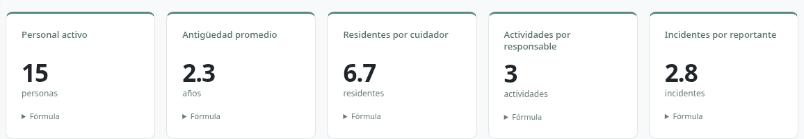
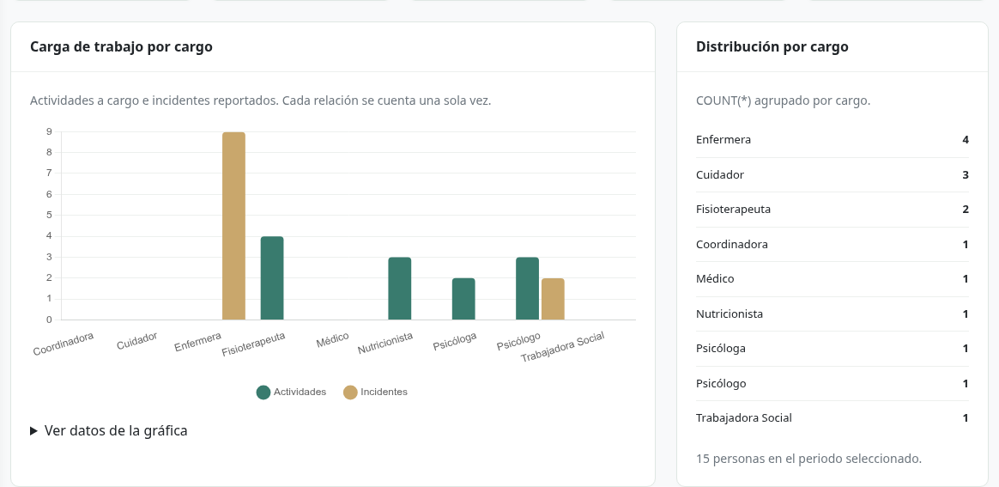
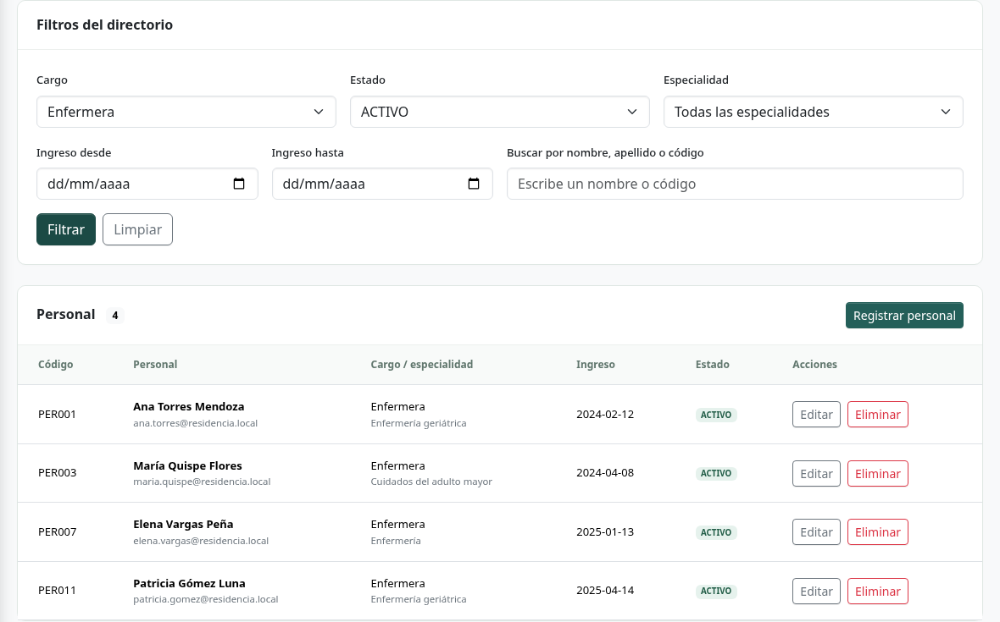
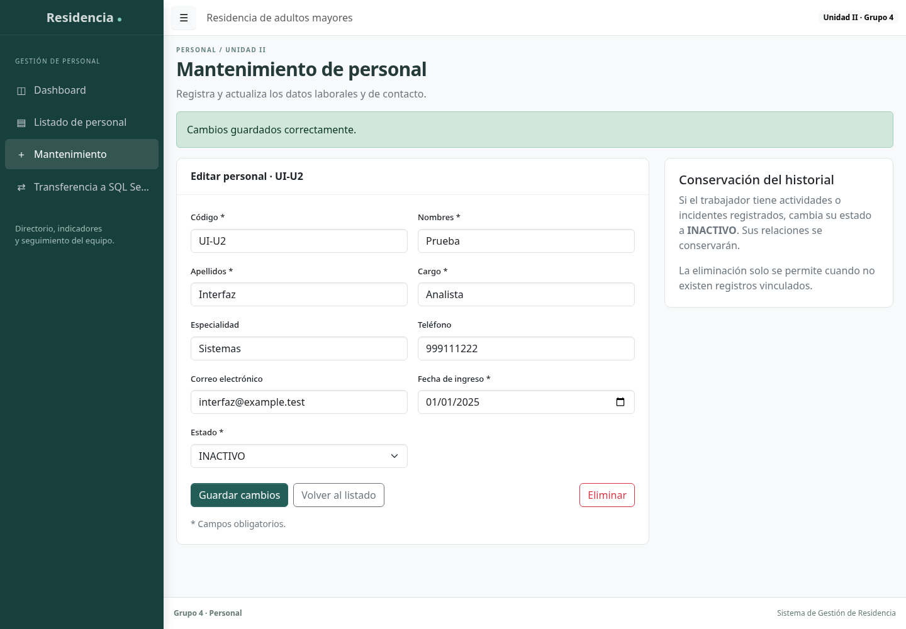
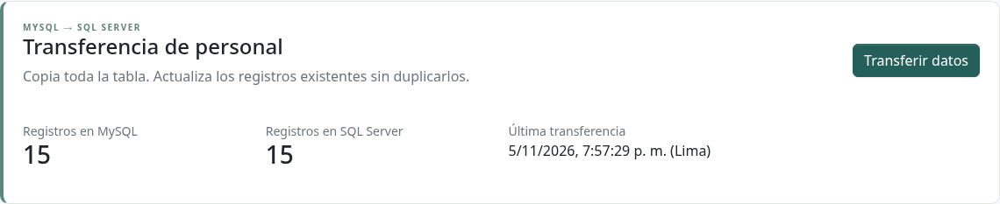

# Personal Grupo 4

Aplicación de la Unidad II del Sistema de Gestión de Residencia para Adultos Mayores. Continúa el módulo Personal de la primera unidad mediante una API REST en Flask y una interfaz AdminLTE.

## Integrantes

- Santillán Valle Jhon Kelvin
- Salazar Salazar Luis Grimaldo
- María Carmen Tuesta Chuquizuta
- Ramos Ocampo Kevin

## Funcionalidad

- Dashboard con seis indicadores, distribución por cargo y gráfica de actividades frente a incidentes.
- Registro, consulta, actualización y eliminación del personal.
- Baja lógica mediante estado INACTIVO y protección de trabajadores con relaciones.
- Filtros por cargo, especialidad, estado, búsqueda y rango inclusivo de fecha de ingreso.
- Transferencia transaccional a SQL Server con MERGE por llave primaria, conteos y resumen.
- Colección Postman y pruebas de integración.

## Evidencias de funcionamiento

Capturas reales de la aplicación en ejecución con datos académicos sintéticos.

### Dashboard de indicadores

El dashboard muestra 15 trabajadores activos y los indicadores calculados por la API. Cada tarjeta permite consultar la fórmula correspondiente.

### Gráfica y distribución por cargo

La gráfica compara las actividades a cargo y los incidentes reportados. El panel lateral muestra la distribución del personal por cargo.

### Listado con filtros combinados

La combinación del cargo Enfermera y el estado ACTIVO devuelve cuatro registros. La pantalla también incluye filtros por especialidad, fecha de ingreso y búsqueda textual.

### Mantenimiento y baja lógica

La captura muestra la actualización del registro ficticio UI-U2 al estado INACTIVO y la confirmación de que los cambios se guardaron correctamente.

### Protección del historial

Cuando el trabajador tiene actividades o incidentes asociados, la aplicación rechaza su eliminación e indica que debe cambiarse su estado a INACTIVO.

### Transferencia a SQL Server

El resumen muestra 15 registros en MySQL y 15 en SQL Server, junto con la fecha de la última transferencia. En la primera ejecución se insertaron 15 registros. Al repetirla, se insertaron 0 y se actualizaron 15.

## Arquitectura

| Componente | Tecnología |
| --- | --- |
| API | Python, Flask y Blueprint |
| Origen | MySQL 8 y PyMySQL |
| Destino | SQL Server y pyodbc |
| Interfaz | AdminLTE 4.10.0, Bootstrap 5.3.8 y Chart.js 4.5.1 |
| Configuración | Variables de entorno y python-dotenv |

Los recursos de la interfaz se distribuyen localmente en `static/vendor`, con sus licencias. Se utiliza la versión oficial disponible de AdminLTE 4.10.0; la carpeta 4.10.1 mencionada por el plan no fue suministrada.

## Datos y alcance

Se conservan el módulo Personal y la asignación del Grupo 4. Los datos académicos heredados contienen un incidente sin reportante: el indicador correspondiente es 11 / 4 = 2,8. El filtro temporal selecciona la fecha de ingreso del personal. Los indicadores se calculan en SQL y controlan la división entre cero.

## Persistencia y seguridad

El esquema MySQL se encuentra en `sql/mysql_sistema_residencia.sql` y requiere una base nueva. El destino está en `sql/sqlserver_personal.sql`; no usa IDENTITY ni llaves foráneas y añade `fecha_transferencia`. La tabla auxiliar conserva el resultado de la última transferencia, incluso con origen vacío.

Las credenciales se leen de `.env`, excluido de Git, tomando `.env.example` como contrato de configuración. Los usuarios de aplicación tienen permisos restringidos. La aplicación utiliza consultas parametrizadas, valida entradas y evita registrar datos personales o credenciales. El servidor de desarrollo se limita a 127.0.0.1. La autenticación pertenece al módulo común de seguridad y no se implementa en este avance.

La transferencia inserta y actualiza; no elimina filas del destino. Un código único en conflicto causa rollback de toda la operación. La baja lógica conserva la identidad e historial del trabajador.

## Verificación

22 pruebas de integración aprobadas con MySQL 8.0.46 y SQL Server 2025. Incluyen CRUD, filtros, fechas, validaciones, relaciones, idempotencia, actualización del destino, rollback y conexiones no disponibles. Las pruebas exigen bases aisladas con sufijo `_test`, mediante `TEST_MYSQL_DATABASE` y `TEST_SQLSERVER_DATABASE`.

También se verificaron 18 peticiones con curl y el flujo de la interfaz en escritorio y móvil. La colección reproducible se encuentra en `postman/coleccion.json`.
