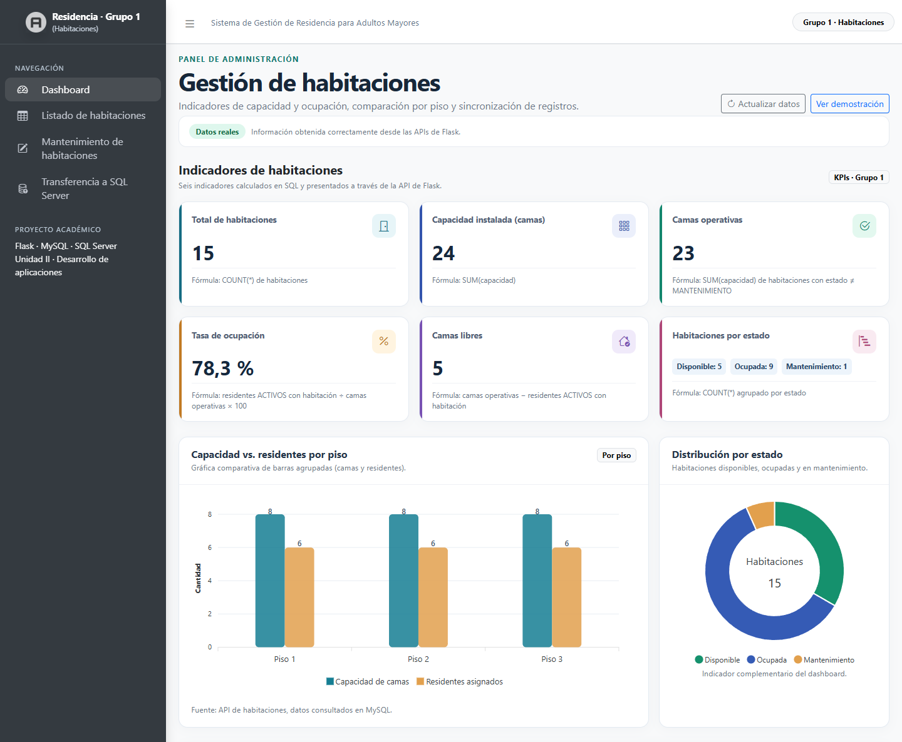
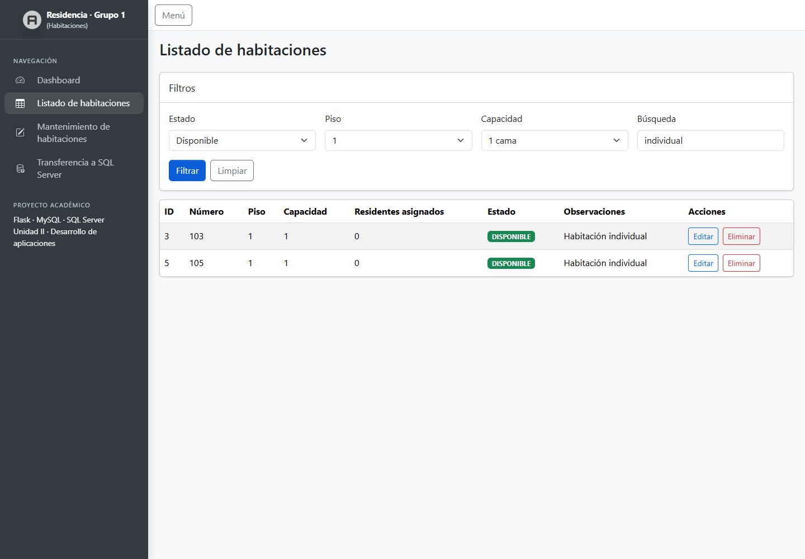
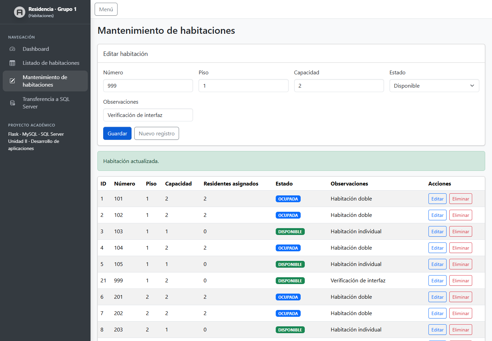
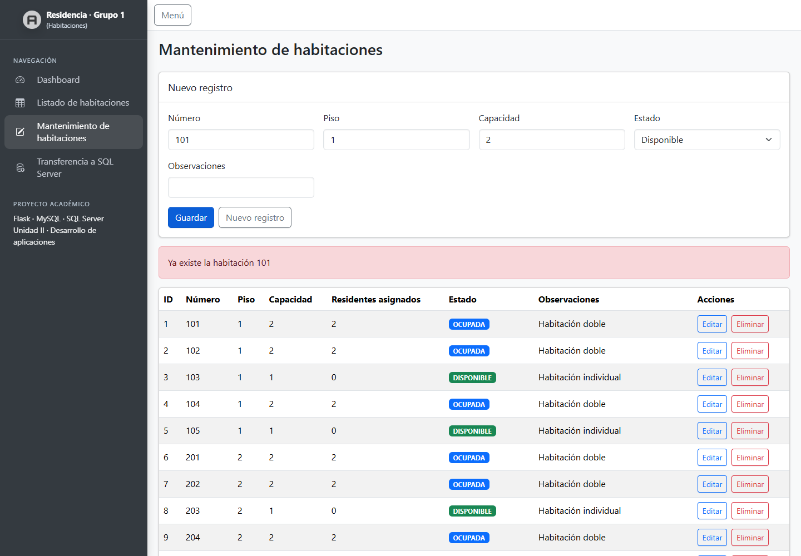
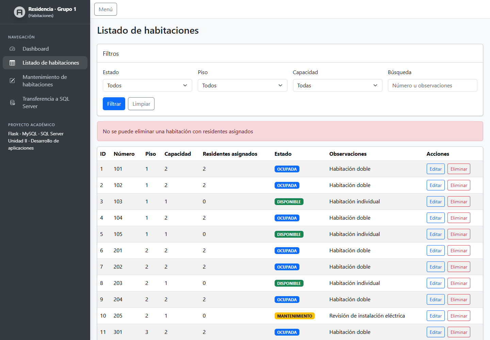
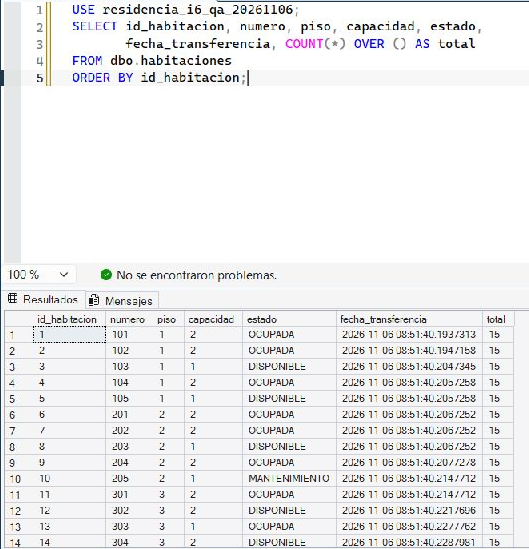
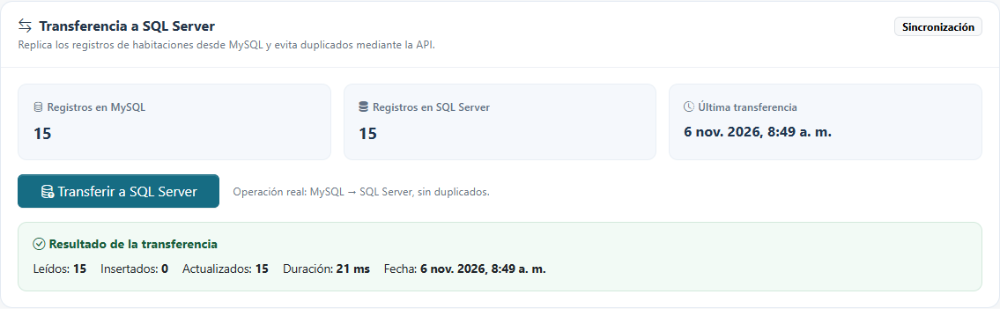
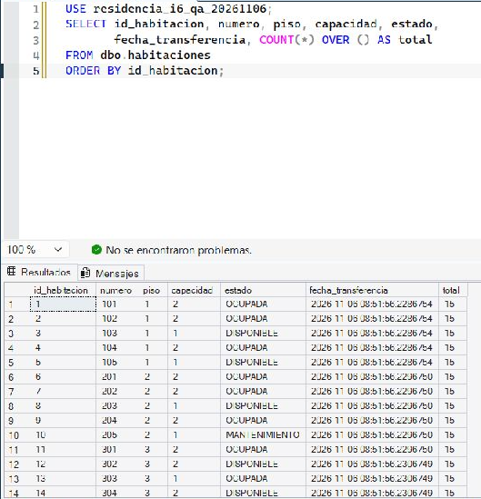
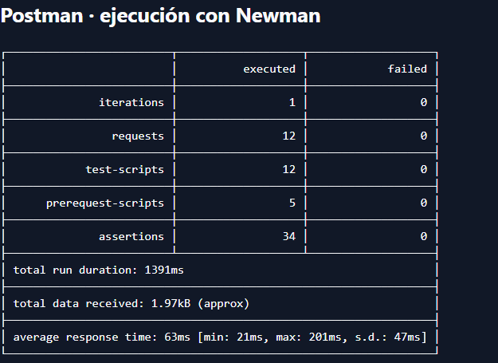

# Informe del Grupo 1 · Módulo Habitaciones

**Proyecto:** Sistema de Gestión de Residencia para Adultos Mayores
**Curso:** Unidad II · Plataformas
**Consolidación y QA:** Frank Salon Trigoso, Integrante 6

## Aportes por integrante

| Integrante | Aporte | Archivos principales |
| --- | --- | --- |
| 1 · Roberto José Ynga Vargas | Preparó la aplicación Flask, registró el Blueprint de habitaciones y configuró el acceso a MySQL. Incorporó el script oficial, las dependencias, la plantilla de entorno y los recursos de AdminLTE 4. | [Flask](../app.py), [configuración](../config.py), [conexión MySQL](../db_mysql.py), [script oficial](../database/sistema_residencia.sql) |
| 2 · Jheison Wesley Ramos Becerra | Implementó los endpoints de KPIs y de gráfica por piso. Calculó la ocupación con residentes activos asignados y camas operativas. | [KPIs y gráfica](../habitaciones/kpis_grafico.py) |
| 3 · Valentin Fernández Campos | Implementó el listado con filtros y la API de alta, consulta, edición y borrado. Validó números duplicados y bloqueó el borrado de habitaciones con residentes asignados. | [Rutas de listado y CRUD](../habitaciones/routes.py) |
| 4 · Puerta Culqui Leydi | Implementó la conexión y la tabla destino en SQL Server. La transferencia utiliza el ID de habitación para insertar o actualizar y devuelve los conteos de cada operación. | [Conexión SQL Server](../db_sqlserver.py), [transferencia](../habitaciones/transferencia.py), [tabla destino](../sql/sqlserver_habitaciones.sql) |
| 5 · Huaman Huaman Lilian | Construyó el dashboard y el menú AdminLTE. Conectó la interfaz a los indicadores, las gráficas y la transferencia. | [Dashboard](../html/index3.html), [JavaScript](../static/js/dashboard.js) |
| 6 · Frank Salon Trigoso | Construyó las vistas de listado y mantenimiento, preparó la colección Postman, ejecutó las pruebas de integración y consolidó el informe con las evidencias. | [Listado](../html/tables/data.html), [mantenimiento](../html/crud.html), [colección](../postman/coleccion.json) |

## Entorno y resultados

La prueba del 6 de noviembre de 2026 se hizo con Flask, el script oficial cargado en MariaDB 10.4.32 compatible con MySQL y una base aislada de SQL Server. La colección se ejecutó con Newman.

| Prueba | Resultado |
| --- | --- |
| KPIs oficiales | 15 habitaciones, 24 camas instaladas, 23 camas operativas, 78,3 % de ocupación y 5 camas libres. |
| Listado | Disponible y piso 1 devolvieron 103 y 105. La interfaz obtuvo las mismas filas al añadir capacidad de una cama y la búsqueda «individual». Limpiar recuperó las 15 filas. |
| CRUD | Alta, consulta, edición y borrado de la habitación temporal 999. La consulta posterior devolvió HTTP 404. |
| Reglas de mantenimiento | El alta duplicada de 101 y su borrado con residentes devolvieron HTTP 409. La edición de 303 conservando su capacidad devolvió HTTP 200. |
| Primera transferencia | 15 leídas, 15 insertadas y 0 actualizadas. SSMS confirmó 15 filas. |
| Segunda transferencia | 15 leídas, 0 insertadas y 15 actualizadas. SSMS confirmó 15 filas. |
| Colección Postman | 12 peticiones, 34 comprobaciones y 0 fallos. |

## Evidencias

### 1. Dashboard con KPIs y gráfica por piso

### 2. Listado con cuatro filtros aplicados

### 3. Edición de la habitación temporal

### 4. HTTP 409 por número duplicado

### 5. HTTP 409 por residentes asignados

### 6. Primera transferencia en el dashboard

### 7. Tabla de SQL Server tras la primera transferencia

### 8. Segunda transferencia en el dashboard

### 9. Tabla de SQL Server tras la segunda transferencia

### 10. Ejecución de la colección Postman

## Referencias del proyecto

- [Plan maestro y reparto de tareas](../plan_maestro_grupo1_habitaciones_prompts_ia.md)
- [Puesta en marcha](../README.md)
- [Informe consolidado en PDF](informe_grupo1.pdf)
